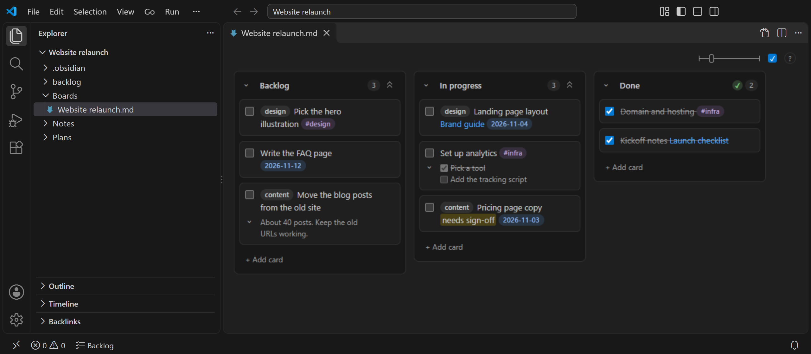
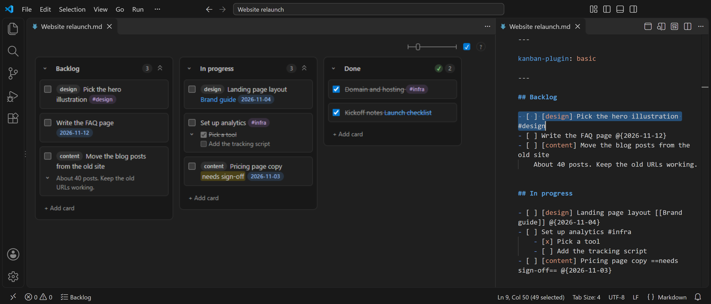
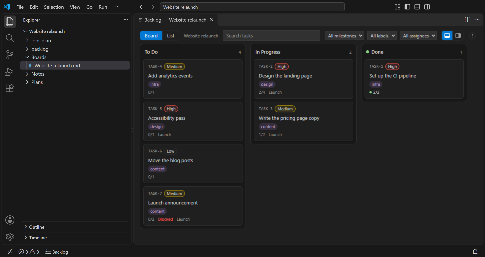
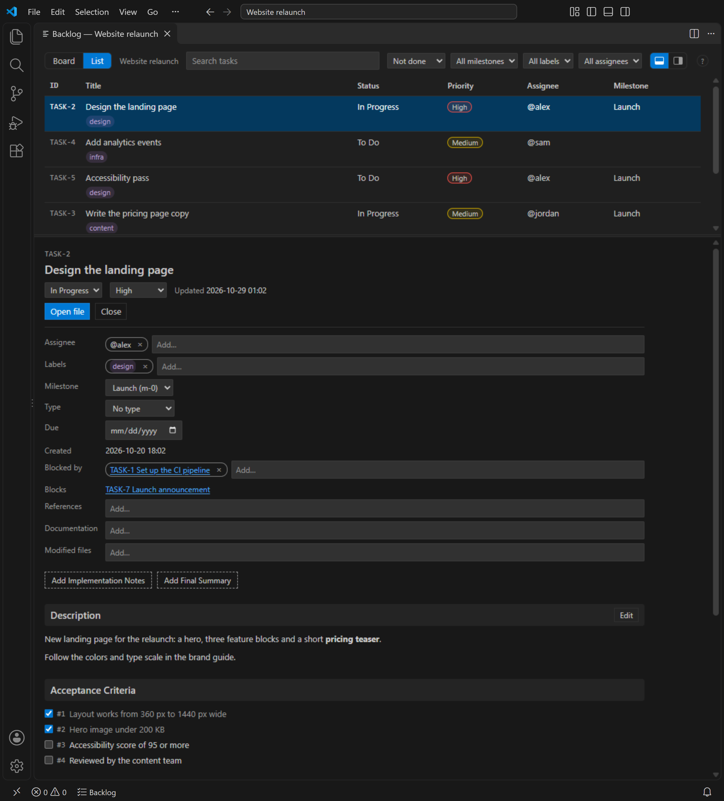
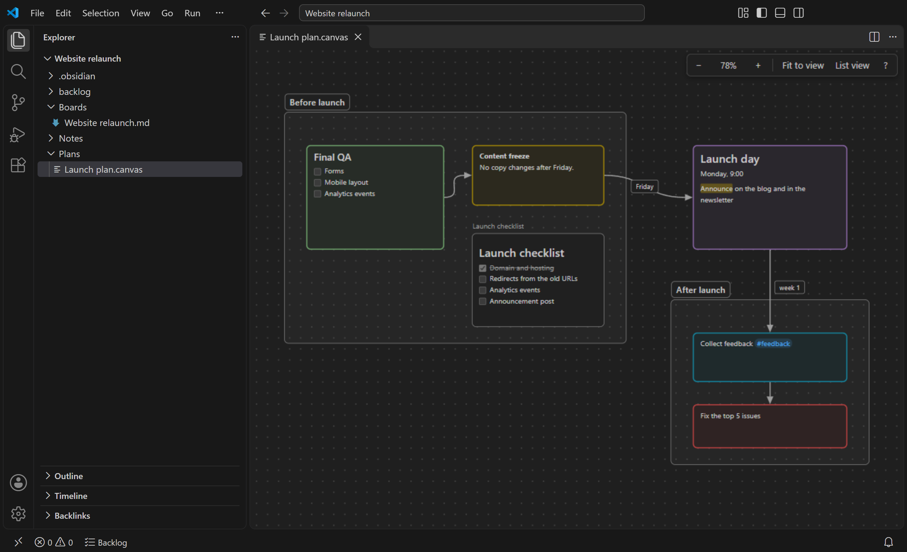

# Notewell

Task boards in VS Code — work with your Obsidian Kanban boards and Backlog.md tasks right next to your code, while the original tools keep working on the same files.

**English** · [한국어](README.ko.md)

> **Preview.** 0.8.0 is the first public release; expect rough edges. Please report problems and ideas in [GitHub issues](https://github.com/nodewell/notewell/issues).



## Why

I plan my work in [Obsidian](https://obsidian.md) and track project tasks with [Backlog.md](https://github.com/MrLesk/Backlog.md), but write most of my code in VS Code. Switching between the editor, Obsidian and the Backlog.md browser view to check schedules and tasks got tedious, so I built Notewell to do that work inside the editor.

- **Obsidian** — a note-taking app that keeps notes as plain Markdown files in a local folder (a vault). With the [Kanban plugin](https://github.com/mgmeyers/obsidian-kanban), a note becomes a board for planning and scheduling.
- **Backlog.md** — a task manager and Kanban board for humans and AI coding agents working in the same Git repository. Each task is a Markdown file with a description, acceptance criteria and an implementation plan, so you review the agent's work task by task (the spec, the plan, then the code) instead of reading thousands of generated lines at once. Finished tasks stay in Git as a record of what was done and why.

The Obsidian Kanban plugin and Backlog.md keep boards and tasks as markdown files, but their boards live in their own app or a browser tab. Open the same files in VS Code and you get raw markdown: lanes as headings, tasks as frontmatter.

Notewell opens them as boards inside VS Code, so you can move cards, change task status and check off criteria without leaving the editor. It follows each tool's own format and settings and rewrites only the lines it changes, so the original tool keeps working on the same files. It does not try to replace those tools, only to cover the everyday board work you do next to your code.



Each feature follows one original tool and only shows up in workspaces that use it.

## Features

| Feature | Original tool |
|---|---|
| [Kanban](#kanban) — view and edit boards made with the Kanban community plugin | Obsidian |
| [Backlog](#backlog) — board, list and detail views of tasks; status changes, field editing and acceptance-criteria checks | Backlog.md |
| [Vault links and attachments](#vault-links-and-attachments) — link updates on rename, attachments, backlinks, link preview | Obsidian |
| [Daily notes and templates](#daily-notes-and-templates) | Obsidian |
| [Canvas](#canvas) — view and edit `.canvas` files (JSON Canvas) | Obsidian |

## Install

Requires VS Code 1.100 or later. Built and checked against Obsidian 1.14, the Kanban plugin 2.0.51 and Backlog.md 1.54.

- **Marketplace**: search for **Notewell** in the Extensions view, or open the [Marketplace page](https://marketplace.visualstudio.com/items?itemName=nodewell.notewell).
- **From a .vsix**: download `notewell-<version>.vsix` from [GitHub Releases](https://github.com/nodewell/notewell/releases), then run **Extensions: Install from VSIX...** from the Command Palette and pick that file.
- **From source**: `npm run package` (see [Development](#development)) creates `notewell-<version>.vsix`.

What changed in each version: [CHANGELOG.md](CHANGELOG.md).

## Get started

- **Kanban**: open a board's `.md` file, or right-click a folder in the Explorer and choose **New Kanban Board**.
- **Backlog**: in a folder with a Backlog.md project, click **Backlog** in the status bar.
- **Canvas**: open a `.canvas` file.
- **Daily notes and templates**: in a vault, run **Notewell: Open Today's Daily Note** or **Notewell: Insert Template** from the Command Palette.
- **Links and attachments**: these work on their own in a vault. Rename a note, or paste an image into one.

## Using Notewell

### Kanban

Markdown files whose frontmatter has a `kanban-plugin:` key open as a board (or use **Notewell: Open as Board** / **Open as Text** on any `.md` file).

- **Notewell: New Kanban Board** (Command Palette, or right-click a folder in the Explorer) creates a new board file in the Obsidian Kanban format, so no Obsidian is needed to start one.
- Check and uncheck cards, add cards, drag cards between lanes and lanes around, rename lanes.
- Edit a card as multi-line text, the way Obsidian stores it (indented continuation lines): **Enter** saves, **Shift+Enter** starts a new line, **Esc** cancels.
- Keyboard: arrows move focus, **Alt+arrows** move cards and lanes, **Space** toggles, **F2** or **Enter** edits, **Ctrl+Enter** opens the card in the text editor beside the board (card lines selected), **N** adds cards to the lane (Enter adds and keeps the input open for the next card; Esc closes), **Shift+F10** opens the card menu, **Delete** deletes the card after a confirmation.
- Card menu (right-click, the **⋯** button or Shift+F10): edit, open in text editor, add, change or remove the date, duplicate, insert a card before or after, move to the top, bottom or another lane, delete.
- Date picker: pick a date in a small popup (**Enter** confirms, **Esc** cancels) from the card menu, or by clicking the card's first date (or **Enter** on it). Dates are written as `@{…}` in the board's date format, the way Obsidian Kanban does; boards that link dates to daily notes or use another date trigger keep their dates as they are.
- Cards show `[[wikilinks]]` (opens the note), `#tags`, dates `@{2026-10-20}` / `@[[2026-10-20]]` (past and today stand out), times `@@{09:30}`, a leading `[category]`, `==highlights==`, bold, italic and code. Everything else stays plain text.
- Card bodies: the indented lines under a card show below it as Markdown (tables, lists, checklists, code). Fold a card with its arrow or **Ctrl+Shift+[** / **Ctrl+Shift+]**, a whole lane from its header, or every card with **Notewell: Collapse All Card Bodies** / **Expand All Card Bodies**; `notewell.kanban.cardBodies` sets how boards open. Folding changes only the view, never the file.
- Card preview: resting the pointer on a folded card shows the whole card in a popup; **Ctrl+K Ctrl+I** does the same for a selected card with a body (`notewell.kanban.cardPreview`).
- Look: `notewell.kanban.style` follows the VS Code theme (default), the vault's Obsidian theme colors, or Notewell's own palette.
- Done lanes: a `**Complete**` line in the lane, or names listed in `notewell.kanban.doneLanes`. Moving a card into or out of a done lane checks or unchecks it.
- Every change edits only the lines involved, goes through the normal editor (so **Ctrl+Z** works) and is saved right away unless `notewell.kanban.saveOnEdit` is off. If the file changed meanwhile, the board refuses the change and redraws.
- Card checkboxes show as in Obsidian: when the board's "Display card checkbox" setting is on (or, if the board does not say, the Kanban plugin's default). The checkbox button at the top right of the board turns it on or off for that board; it changes only `show-checkboxes` in the board's settings block, so Obsidian follows too. Space checks a card either way.
- Lane width follows the board's "List width" (or the Kanban plugin's default, or Obsidian's 272 px). The slider next to the checkbox button changes it for that board: lanes follow while you drag, and `lane-width` in the board's settings block is written once you let go, so Obsidian shows the same width. Double-click the slider for the default width.
- Boards that use another date or time trigger in their settings show dates and times written with that trigger, as Obsidian does.
- Not yet: deleting lanes, archive editing, and board settings other than the checkbox switch and lane width.
- So that VS Code opens a board directly (no extra text tab from the Explorer), each file you open as a board is added to `workbench.editorAssociations` in your VS Code user `settings.json`. **Open as Text** removes its entry; turn off `notewell.kanban.rememberBoards` to remove them all.

Settings: `notewell.kanban.enabled`, `notewell.kanban.openBoardsByDefault`, `notewell.kanban.rememberBoards`, `notewell.kanban.saveOnEdit`, `notewell.kanban.doneLanes`, `notewell.kanban.style`, `notewell.kanban.cardBodies`, `notewell.kanban.cardPreview`.

### Backlog

For workspaces with a [Backlog.md](https://github.com/MrLesk/Backlog.md) project (`backlog/`, `.backlog/` or `backlog.config.yml` at a workspace folder root). Open the project's tasks in an editor tab — no browser, no `backlog` process — with the **Backlog** button in the status bar, **Open Backlog** on the task folder's right-click menu in the Explorer, the board button in the title bar of a task file opened as text (selects that task), or **Notewell: Open Backlog** in the Command Palette.



The list and a task's details together: read everything in one place, and edit fields, text and checks right there.



- **Board**: one column per configured status. Drag a card to another column (or **Alt+Left/Right**) to change its status.
- **List**: sortable columns (ID, title, status, priority, assignee, milestone), filters for status, milestone, label and assignee, and search over ID, title, the whole task body, labels and assignees (every word must appear, in any order; spacing in the task is ignored).
- **Details**: every field, the description, plan, notes, comments and final summary, rendered as Markdown and never cut off. Check off acceptance criteria and Definition of Done items, change the status, follow links to parent, subtasks and dependencies, and open the task file as text.
- **Editing in the details**: title, priority, type, milestone, due date, assignees, labels, dependencies (unknown IDs and cycles are refused), references, documentation and modified files; edit the description, plan, notes and final summary (**Ctrl+Enter** saves, **Esc** cancels) and add comments.
- **Order within a column**: drag a card up or down, or **Alt+Up/Down**.
- Changes edit only the lines involved and update `updated_date` the way the Backlog.md CLI does, so the CLI and its browser keep reading the same files. **Ctrl+Z** in the panel undoes the last change made there. If a task file changed meanwhile, the change is refused and the panel redraws.
- **Layout**: details open below the board or list (default) or on the right — switch with the toolbar buttons (`notewell.backlog.detailPosition`). Drag the splitter between them, or focus it and use the arrow keys, to resize; double-click resets it.
- **Projects in other folders**: a Backlog.md folder that isn't at a workspace folder root can be added with **Notewell: Add Backlog Folder…** or **Register as Backlog Folder** on the folder's Explorer menu (stored in `notewell.backlog.projects`).
- Creating, archiving or completing tasks, drafts, documents, decisions and statistics stay with the Backlog.md CLI.

Settings: `notewell.backlog.enabled`, `notewell.backlog.saveOnEdit`, `notewell.backlog.detailPosition`, `notewell.backlog.projects`.

### Vault links and attachments

For Markdown notes inside an Obsidian vault (a folder with `.obsidian/`).

- **Link updates on rename**: renaming or moving a note in VS Code updates the wikilinks and Markdown links that point to it, keeping how each link was written; one **Ctrl+Z** undoes both. VS Code shows the link changes for confirmation first (`notewell.links.updateOnRename`). Updated files are not saved for you unless `notewell.links.saveUpdatedFiles` is on.
- **Attachments**: pasting or dropping an image or file saves it where Obsidian's attachment setting says (`notewell.attachments.folder` overrides) and inserts the embed in the vault's link format. Existing files are never overwritten.
- **Backlinks**: a Backlinks view in the Explorer lists the notes that link to the current one (unlinked mentions with `notewell.backlinks.unlinked`).
- **Link preview**: hover a link to see the start of the target note (or the heading/block); **Ctrl+click** opens it.
- **Missing notes**: **Ctrl+click** on a wikilink to a note that does not exist asks, then creates an empty note where Obsidian puts new notes (or in the folder written in the link, made if missing, as Obsidian does). `notewell.links.createMissingNotes`: `ask` (default) or `never`.

Settings: `notewell.links.enabled`, `notewell.links.updateOnRename`, `notewell.links.saveUpdatedFiles`, `notewell.links.createMissingNotes`, `notewell.attachments.enabled`, `notewell.attachments.folder`, `notewell.backlinks.unlinked`, `notewell.linkPreview.enabled`.

### Daily notes and templates

For vaults with Obsidian's Daily notes or Templates settings. The notes come out as Obsidian makes them: same folder, file name, template and variables.

- **Notewell: Open Today's Daily Note** opens today's note, or creates it from the Daily notes folder, date format and template. **Open Daily Note for Date…** does the same for a typed date (`YYYY-MM-DD`, today, yesterday, tomorrow). As in Obsidian, the Daily notes folder must exist; folders from the date format (`YYYY/MM/…`) are made; without a folder setting the note goes where Obsidian puts new notes; a template that is set but missing makes no note. An existing note is opened, never changed.
- **Notewell: Insert Template** puts a note from the Templates folder at the cursor (replacing the selection), with `{{title}}`, `{{date}}`, `{{time}}` and `{{date:FORMAT}}` / `{{time:FORMAT}}` filled in; other `{{…}}` stay as written. One **Ctrl+Z** undoes it. A template's frontmatter goes in only at the start of a note without frontmatter. **Insert Current Date** / **Insert Current Time** use the Templates formats.
- Month and weekday names are English or Korean, as in an English or Korean Obsidian app: `notewell.dailyNotes.dateLanguage` (`auto` follows the VS Code language). Date formats with tokens Notewell does not know (such as `LL`) are refused rather than guessed.

Settings: `notewell.dailyNotes.enabled`, `notewell.dailyNotes.dateLanguage`, `notewell.templates.enabled`.

### Canvas

`.canvas` files ([JSON Canvas](https://jsoncanvas.org), the format of Obsidian Canvas) open in a canvas view by default. For the raw JSON, use **Reopen Editor With… → Text Editor**.



- Text, file, link and group cards with their colors, and edges with arrows and labels, drawn as Obsidian draws them. Text cards show Markdown with `==highlights==`, `[[wikilinks]]` (open the note) and `#tags`; note cards show the note; image cards the image (images inside the vault); link cards the URL (opened in the browser after a confirmation). File and link names sit above the card.
- Pan by dragging the background (or **Space**+drag) or scrolling; zoom with **Ctrl+wheel** or **+**/**−**; **Shift+1** fits the canvas. **List view** shows every card as text, for screen readers.
- Editing: drag a card to move it (a group takes its cards along) or its corner to resize; **arrows** move the selected card (**Shift**: 50 px), **Alt+arrows** resize, **C** picks one of six colors, **Enter** edits a text card (**Ctrl+Enter** saves, **Esc** cancels).
- Each edit changes only the values involved and goes through the normal editor (**Ctrl+Z** works); nothing is saved for you. Selecting a card never changes the file. If the file changed meanwhile, the edit is refused and the view redraws. Files over 5 MB or 5,000 cards open read-only.
- Not yet: creating or deleting cards and edges, changing connections or group labels, web page previews, PNG export.

Settings: `notewell.canvas.enabled`, `notewell.canvas.editable`, `notewell.canvas.snapToGrid`.

## Principles

- **Byte-preserving edits.** Only the lines an action changes are rewritten. Open and save without changes = identical file.
- **Follows the original tool.** Reads its settings (`.obsidian/`, Backlog.md `config.yml`) and never writes to them (the only settings Notewell writes are VS Code settings, such as the editor associations above). When Notewell edits a file, it updates the same metadata the original tool would.
- **No runtime dependencies, no network, no external processes.** Notewell never runs the original tool's CLI; it follows the file format directly. Webviews run under a strict Content Security Policy.

## Development

Requirements: Node.js 24 or later (tests run TypeScript directly with Node's built-in type stripping).

```sh
npm ci              # install dev tools (there are no runtime dependencies)
npm run build       # bundle to dist/ (extension.cjs and webview assets)
npm run typecheck   # tsc for the extension and for the webview scripts
npm test            # node:test over test/**/*.test.ts
npm run package     # production build + .vsix
```

Test fixtures live in [test/fixtures](test/fixtures).

## License

[MIT](LICENSE) © nodewell

Notewell is an independent project and is not affiliated with or endorsed by Obsidian (Dynalist Inc.), the Kanban plugin's author, or Backlog.md.
